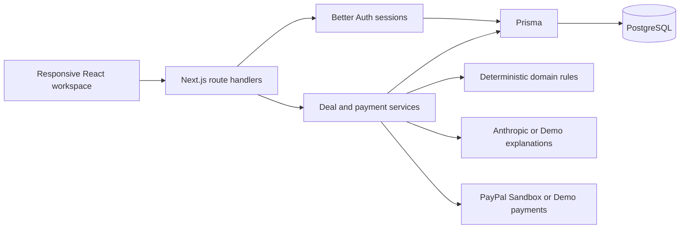

# DealSphere

One workspace for offers, bounded agents, agreed work, invoice checks, and human-approved payments.

Created by Yestay Arnuruly & Kaisarbek Sansyzbay

DealSphere is a local full-stack MVP. Its eight modules share users, deals, agreement versions, invoices, payments, and an activity history. The default configuration runs deterministic Demo AI and a separate Demo payment adapter; neither requires external API keys or moves money.

## Run locally

On Windows, after dependencies are installed, the helper starts local PostgreSQL, applies migrations, preserves existing seeded scenarios, and starts the app in hidden processes:

```powershell
powershell -ExecutionPolicy Bypass -File .\start.ps1
```

Open `http://localhost:3000`. Stop those helper processes with `powershell -ExecutionPolicy Bypass -File .\stop.ps1`. After `npm run build`, add `-Production` to start the production server. The helper creates a random session secret only when `.env` is absent; existing configuration is preserved. Optional ignored `.tools/runtime.local.json` supplies this workstation's Node and database paths. See [this workstation's local setup](docs/LOCAL_SETUP.md) for the installed runtime location.

Prerequisites: Node.js 22.16 or newer, npm, and a running PostgreSQL database. The included Docker Compose file runs PostgreSQL 17 on `127.0.0.1:5432` with a persistent named volume. It does not expose the database on the network.

```sh
npm ci
cp .env.example .env
```

On PowerShell, copy the configuration with:

```powershell
Copy-Item -LiteralPath .env.example -Destination .env
```

Set a private `BETTER_AUTH_SECRET` in `.env` before starting. Generate one with:

```sh
node -e "console.log(require('node:crypto').randomBytes(32).toString('hex'))"
```

The example `DATABASE_URL` matches Docker Compose. Then start the database and apply the schema:

```sh
docker compose up -d
docker compose ps
```

Wait until the `db` service is healthy, then run:

```sh
npm run db:generate
npm run db:migrate
npm run db:seed
npm run dev
```

Open [http://localhost:3000](http://localhost:3000). Use this exact origin because the authentication and mutation handlers validate it against `BETTER_AUTH_URL`. The application server binds to the local machine.

For a local production build:

```sh
npm run build
npm start
```

Change `BETTER_AUTH_URL` when changing the application origin, and restart the server. Keep `.env` private; only `.env.example` belongs in version control.

### Optional database without Docker

The included `scripts/local-postgres.mjs` can start a persistent local PostgreSQL instance using the `embedded-postgres` development dependency. Its platform binaries are installed with the dependencies. This fallback uses the host's local filesystem and is separate from the Docker volume.

After preparing `.env`, start this command in its own terminal:

```sh
npm run db:local
```

Wait for “PostgreSQL is ready”, then run migration, seed, and application commands in another terminal. The helper requires a loopback `DATABASE_URL`, binds to `127.0.0.1`, and defaults to `.data/postgres` for persistent data. Set `LOCAL_PG_DIR` to select another writable data directory. If the configured port already has a listener, it leaves that process alone; your `DATABASE_URL` must still identify a usable PostgreSQL database. Stop the helper with Ctrl+C when finished.

## Demo accounts and data

All seeded accounts use the password `DealSphere123!`.

| Account | Email | Purpose |
| --- | --- | --- |
| Buyer | `buyer@demo.dealsphere.test` | Owns the three seeded demonstration deals |
| Seller | `seller@demo.dealsphere.test` | Main website supplier and group seller |
| Second seller / group member | `east@demo.dealsphere.test` | Another website offer and an individual group share |
| Third seller | `west@demo.dealsphere.test` | Another website offer |
| Isolated account | `outsider@demo.dealsphere.test` | Demonstrates an empty workspace and private-deal isolation |

Buyer, Seller, and New member shortcuts are available on the sign-in screen. Use the email/password form for the other accounts. Sign out before switching accounts, or use separate browser profiles. Roles belong to each deal; the server derives the actor from the authenticated session.

The seed creates a $300 website request, three offers, five saved demonstration negotiation rounds, mutually confirmed terms, a pending $150 blog change request, a blocked $450 invoice, a corrected $300 invoice, and an accepted demonstration milestone. It also creates a CSV bounty with passing/failing submissions and a keyboard group purchase with explicit volume tiers.

The seed preserves an existing demonstration workspace. Running it again refreshes the demo credentials; it does not erase completed actions. When switching payment mode, it can update the two unpaid seeded website invoice recipients and invalidate their approvals. For a fresh demonstration, point `DATABASE_URL` at a new empty database, then migrate and seed it.

See [the three-minute demonstration](docs/DEMO.md) for the connected workflow and additional module scenarios.

## Implemented modules

| Module | Working scope |
| --- | --- |
| BuyPilot | Internal demo catalog, seller-entered offers, saved requirements and budgets, field-cited offer comparisons |
| AgentArena | Saved, deterministic negotiations with one offer per seller, up to three sellers and five rounds, private price/delivery limits, step/stop controls, comparison table |
| ScopeLock | Separate agreement versions, buyer/seller confirmations, advisory scope classification, change requests that apply only after both parties confirm |
| FreelanceFlow | Milestone start, submission, revision requests with comments, buyer acceptance, invoice linkage, saved reminder drafts |
| InvoiceGuard | Server-calculated totals, expected/actual findings, current terms and line schedule checks, recipient/currency checks, duplicate supplier numbers, acceptance and payment checks |
| BountyLab | CSV upload, saved source attachment and validation report, required columns/values, row bounds, uniqueness and configured numeric types, one buyer-accepted result |
| CrowdCart | Invited participants, quantities, published discount tiers, locked roster/prices, seller confirmation, individual member confirmations/invoices/payments, incomplete collection status |
| AccessBridge | Text conversation, reviewable deal drafts, explanations and navigation; optional browser voice input/read-aloud with text fallback |

The interface includes Overview, Marketplace, Deals, AgentArena, Projects, Bounties, Group buys, Invoices, Payments, Activity, Settings, and About. Dashboard values come from the signed-in user's saved records. Demo payments and verified Sandbox captures are labeled separately.

## Agreement and payment rules

Money is stored in integer cents. The MVP supports USD, EUR, and GBP; quantities are whole numbers. Invoice totals use exact integer arithmetic: `sum(quantity × unit price) − discount + fixed tax amount`. The amount cap is 100,000,000 cents per supported obligation.

Both buyer and selected seller confirm each agreement version. Applied changes create a new version and invalidate unpaid invoice approvals. InvoiceGuard checks run again at invoice approval and payment capture; a stored approval cannot authorize changed terms or a changed invoice.

Services are invoiced against accepted milestones. Group invoices belong to locked individual member shares. A bounty requires a passing submission, explicit buyer acceptance, and agreed seller terms. The current simple line schedule uses the milestone title, the agreed deliverable, or the locked group product/quantity; it is not a general accounting or tax engine.

A unique database obligation key prevents paying the same milestone, bounty/deal, or member share twice, including through a second invoice. Serializable transactions claim payment creation and capture. Creating an order, returning from PayPal, and marking work accepted do not themselves mark an invoice paid.

## PayPal Sandbox setup

The adapter uses the server-side [PayPal Orders v2 workflow](https://developer.paypal.com/api/rest/integration/orders-api): create an order, obtain buyer approval, capture on the server, and verify the result. Its API host is fixed to `https://api-m.sandbox.paypal.com`. Live money is unsupported.

Create a PayPal Developer Sandbox REST application and a Business test account, plus a separate Personal test account for the buyer. Keep the credentials for the REST application associated with the configured Business test merchant.

Set these server variables:

```dotenv
PAYMENT_MODE="sandbox"
PAYPAL_CLIENT_ID="your-sandbox-rest-client-id"
PAYPAL_CLIENT_SECRET="your-sandbox-rest-secret"
PAYPAL_MERCHANT_ID="your-business-test-merchant-id"
PAYPAL_MERCHANT_EMAIL="your-business-test-account-email"
PAYPAL_SELLER_USER_ID="demo-seller"
```

`PAYPAL_SELLER_USER_ID` maps one local seller to the configured test merchant. Login email and payment recipient are separate: the seeded seller still signs in as `seller@demo.dealsphere.test`, while its Sandbox invoices display `PAYPAL_MERCHANT_EMAIL`. Other sellers cannot receive Sandbox checkout payments through this integration.

After configuring Sandbox, run `npm run db:seed` and restart the application. Review the corrected unpaid invoice again because the payee change invalidates approval. Then:

1. Run InvoiceGuard and approve the current passing invoice as the payer.
2. Open Review payment; check the amount, currency, and recipient.
3. Tick the confirmation and create the Sandbox order.
4. Open PayPal Sandbox and approve with the separate Personal test account.
5. Return to Payments and explicitly choose Capture / check.
6. The server verifies the order binding, merchant ID, currency, amount, capture ID, and completed provider state before recording a Sandbox payment.

This is a direct integration with one configured test merchant. It does not provide marketplace seller onboarding, arbitrary seller payouts, PayPal Invoicing, escrow, automatic refunds, or webhook processing. Marketplace features require a separately supported PayPal platform integration and appropriate onboarding/permissions.

### Uncertain results and cancellation

The payment reservation remains in the database when a network call times out. Retrying capture queries the same saved order first. A capture interrupted by a process restart can be checked again after its two-minute active-operation lease. A pending or unknown result is not paid.

Lost create-order responses can be recovered by retrying the same reserved payment after the two-minute lease, with the original request fingerprint, merchant configuration, application origin, and idempotency key. Recovery is restricted to five hours from the original reservation. The [Orders create API](https://developer.paypal.com/sdk/orders/v2/orders-create/) documents a six-hour default key retention; the application keeps a margin rather than assuming indefinite idempotency.

After that recovery window, or when the original request/configuration no longer matches, the application retains the reservation for manual investigation in the PayPal Sandbox account. Do not remove the reservation or submit a replacement payment as a way to resolve uncertainty. Cancellation stops the local checkout flow; it does not imply a provider refund or release an uncertain obligation.

To return to local simulation, set `PAYMENT_MODE="demo"`, rerun the seed for unpaid seeded recipient changes, and restart. Resolve outstanding Sandbox orders in their original mode before switching.

## Optional live AI

Leave `ANTHROPIC_API_KEY` empty for deterministic Demo behavior. For live explanatory calls, configure both variables on the server:

```dotenv
ANTHROPIC_API_KEY="your-private-key"
AI_MODEL="an-enabled-Anthropic-model-supporting-structured-outputs"
```

Choose a model available to your Anthropic account that supports [structured outputs](https://platform.claude.com/docs/en/build-with-claude/structured-outputs). The adapter calls the Messages API using `output_config.format` with a JSON schema and validates responses with Zod. Comparison citations must refer to actual supplied offers and allowed fields.

Only selected context is sent: public offer fields, scope text, deterministic invoice findings when the explanation helper is used, or authorized deal summaries. Private negotiation limits, authentication credentials, and uploaded document bytes are excluded. Text inside those records is treated as untrusted data. Calls have timeouts; errors are shown instead of silently presenting Demo output as Live AI.

Live AI supplies explanations and proposals. Server rules determine access, money totals, acceptance, and payment eligibility. AgentArena remains an explicitly labeled deterministic simulation even when live explanatory AI is enabled. Some AccessBridge intents use fixed local guidance rather than an external model call.

## Data, access, and files

Better Auth manages email/password sign-in and sessions through its [Prisma adapter and Next.js route](https://better-auth.com/docs/installation). Public sign-up is disabled in this MVP; the seed provisions the demonstration accounts.

Every application mutation validates its origin, authenticated actor, input, object membership, and applicable deal role. Private deal records, history, and attachments are scoped by server queries. Private seller limits are omitted from workspace responses. Request limits are process-local and intended for this local monolith.

Attachments are stored privately in PostgreSQL with authenticated downloads. PDF, PNG, and JPEG files have extension, declared type, signature, and size checks; the limit is 5 MiB. CSV is limited to 1 MiB, 100 columns, 10,000 data rows, and bounded record size. Uploaded content is never executed. Invoice entry is manual; there is no OCR or automatic extraction. File checks are not a malware-scanning service.

Core records are normalized in Prisma: users/accounts/sessions, deals/participants, offers, agreement versions, milestones, change requests, negotiation sessions/messages, invoices/items/reviews, payments, bounty submissions/validation results, group purchases/members, attachments, activity events, and reminder drafts. JSON is reserved for structured criteria, tier tables, and validation findings.

## Architecture



The code is a modular monolith: `components/` contains the interface, `lib/contracts.ts` the client API shapes, `lib/server/` authorization and transactional workflows, `lib/domain.ts` deterministic checks, and `lib/paypal.ts` / `lib/ai.ts` external boundaries. Prisma schema, migrations, and seed live in `prisma/`.

## Checks

Run validation against a dedicated local/test database rather than data you want to preserve:

```sh
npm run lint
npm run typecheck
npm test
npm run test:integration
npm run test:browser
npm run build
```

Unit tests cover exact money arithmetic, invoice mismatches and review invalidation, dual approvals, negotiation limits, CSV validation, group shares, bounded AI output, and mocked PayPal verification/recovery. The integration script requires a running seeded local application/database with `PAYMENT_MODE=demo`; run `npm run dev` in another terminal first. It creates isolated test fixtures and cleans them up.

Playwright starts or reuses the local development server. It uses installed Windows Chrome when available, or the browser at `PLAYWRIGHT_CHROME_PATH`. On another system, install Playwright's browser first with `npx playwright install chromium`. `PLAYWRIGHT_BASE_URL` can select another running origin; keep `BETTER_AUTH_URL` consistent with it. Browser checks expect the original seeded scenarios. See the [local verification record](docs/VERIFICATION.md) for actual results, screenshots, and verification limits.

## MVP limits

- Demo suppliers, accounts, documents, delivered work, and negotiation history are fixtures. There is no internet supplier search, reputation verification, or claimed savings metric.
- Agreement drafts copy the selected offer's terms. Extracting a structured agreement from correspondence with AI is outside this MVP. Scope classification is advisory and does not provide legal arbitration.
- The milestone model is deliberately small: an initial service milestone and milestones created by approved extra work. Milestone setup and reminder drafts use templates; AI-generated milestone plans, a drag-and-drop project planner, and external reminder delivery are not implemented.
- Group recruitment uses explicitly invited deal participants. Locked membership cannot be edited through the UI; organizer attention is available when collection cannot complete. No procurement guarantee or automatic refund is implemented.
- The UI exposes required/unique/numeric CSV criteria. The domain validator also has additional typed checks. CSV reports have deterministic explanations rather than a dedicated live AI summarizer; the product does not execute arbitrary submitted programs.
- Browser speech features depend on browser support and permissions; text remains available. Accessibility provisions include labels, visible focus, keyboard dialogs, and a skip link, but this is not a claim of complete standards certification.
- Public registration, password reset/email delivery, production account administration, distributed rate limiting, background reconciliation, malware scanning, and production monitoring are outside this MVP.
- Real PayPal Sandbox and Anthropic operations require your credentials and account access. Mocked tests and local Demo records are distinct from external integration verification.

## License

[MIT](LICENSE).

Created by Yestay Arnuruly & Kaisarbek Sansyzbay
# Paypal

